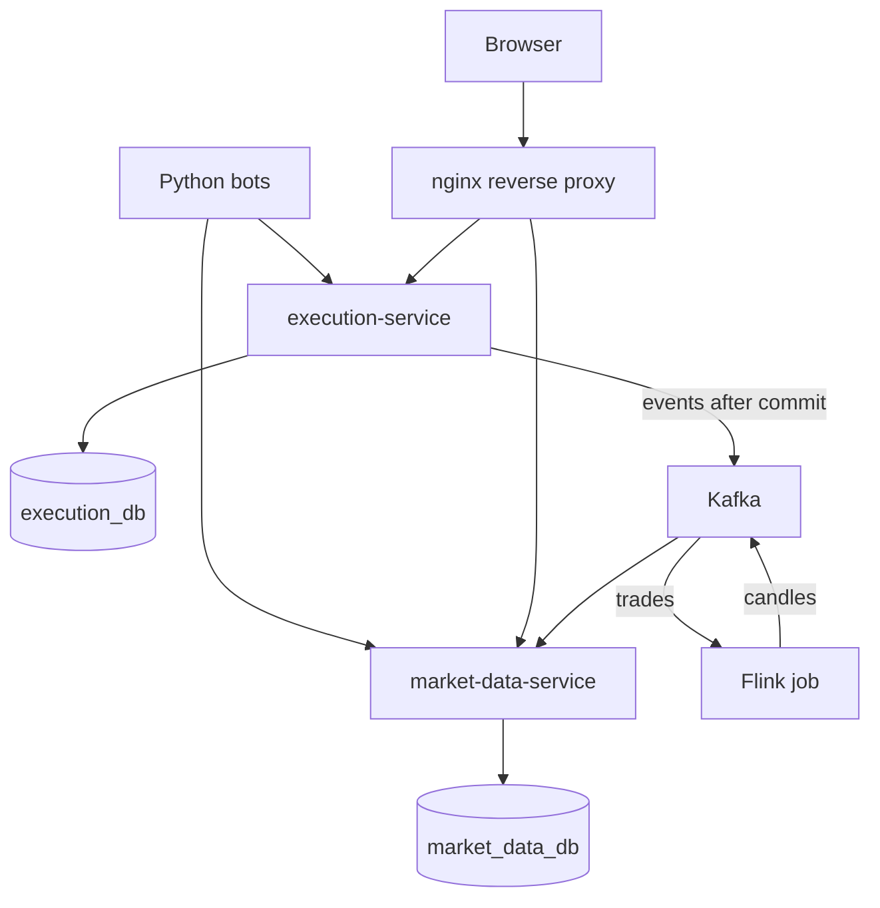

# mini-stock-exchange

A simulated, browser-based stock exchange. People and Python bots trade virtual cash and shares through the same API and rules, and prices emerge from executions against a price-time-priority limit order book. No real money or external market data is involved.

**Status:** early development. All services build and run, and login works through the API. The matching engine and the trading terminal are not built yet.

## Architecture



| Path | Role |
| --- | --- |
| `services/execution-service` | Orders, matching, risk and settlement, committed in one database transaction |
| `services/market-data-service` | Rebuildable public market data |
| `analytics-job` | Flink job that turns trades into one-minute candles |
| `event-contracts` | Avro message schemas shared by the Java modules |
| `api` | The OpenAPI 3.1 contract for the HTTP API |
| `web` | React terminal and the reverse proxy |
| `simulator` | Trading bots |
| `infra` | Database, Kafka and monitoring setup |

Each service owns its own database, with no shared access. Kafka sits downstream of the commit, so trading keeps working if Kafka or Flink is down, and public data goes stale until they return.

## Tech stack

| Area | Technology |
| --- | --- |
| Services | Java 25 (Oracle JDK 25.0.5), Spring Boot 4.1.2, Maven 3.9.16 |
| Persistence | PostgreSQL 18.6, Flyway, plain SQL through `JdbcClient` |
| Messaging | Apache Kafka 4.3.2 (KRaft), Avro 1.12.2 |
| Stream processing | Apache Flink 2.2.1 on Java 17 |
| Frontend | React 19.3, TypeScript 6, Vite 8, TanStack Query and Table, React Router, Lightweight Charts |
| Simulator | Python 3.14 with uv, HTTPX, Pydantic, NumPy |
| Runtime | Docker Compose, nginx, Prometheus, Grafana |
| Testing | JUnit, AssertJ, Testcontainers, ArchUnit, Vitest, Testing Library, pytest, Ruff |

Exact versions are pinned in `pom.xml` files, lockfiles and `compose.yaml`, where images are pinned by digest.

## Run it

You need Docker with Compose v2. On Windows PowerShell:

```powershell
.\scripts\init-env.ps1
docker compose --profile full up -d --build --wait
```

On Linux or macOS, run `./scripts/init-env.sh` instead of the first command. The app is then on <http://localhost:8080>.

`init-env` creates a local `.env` with random secrets. Its `DEV_TRADER_PASSWORD` and `DEV_OPERATOR_PASSWORD` are the passwords for the demo users `trader` and `operator`.

| Command | Starts |
| --- | --- |
| `docker compose up -d --build --wait` | Services, proxy, PostgreSQL and Kafka |
| `docker compose --profile full up -d --build --wait` | The above, plus Flink and the simulator |
| `docker compose --profile observability up -d --wait` | The base stack, plus Prometheus and Grafana |
| `docker compose down` | Stops everything; add `-v` to delete the data too |

## Develop

You need Oracle JDK 25.0.5, a JDK 17 for the Flink tests, Node.js 24.22.2, uv and Docker. Point `JAVA_HOME` at JDK 25 and `JAVA17_HOME` at JDK 17, then:

```powershell
.\mvnw.cmd -B -ntp test                                        # unit tests, no Docker needed
.\mvnw.cmd -B -ntp verify                                      # plus integration tests against real PostgreSQL
.\mvnw.cmd -B -ntp -pl services/execution-service -am verify   # one service
.\scripts\compat-gate.ps1                                      # full stack check in a throwaway Compose project
```

```powershell
cd web; npm ci; npm run typecheck; npm run lint; npm test; npm run build; cd ..
cd simulator; uv sync --frozen; uv run --frozen ruff check .; uv run --frozen pytest -q; cd ..
```

On Linux or macOS, use `sh ./mvnw` and `bash scripts/compat-gate.sh`.

### The API contract

`api/openapi.yaml` is the source of truth for the HTTP API. To change an endpoint, change the contract first, then the code:

- `cd web; npm run api:generate` regenerates the TypeScript types in `web/src/api/schema.ts`. CI runs `npm run api:check` and fails if they are out of date.
- Each service's `ApiContractIT` checks real responses against the contract's schemas, and checks that the routes it serves are exactly the operations tagged with its name.

Run `git config core.hooksPath .githooks` once after cloning. It enables a hook that checks commit messages follow [Conventional Commits](https://www.conventionalcommits.org/). Pull requests need green CI, and new database tables need explicit `GRANT`s to the service's runtime role in their migration.
