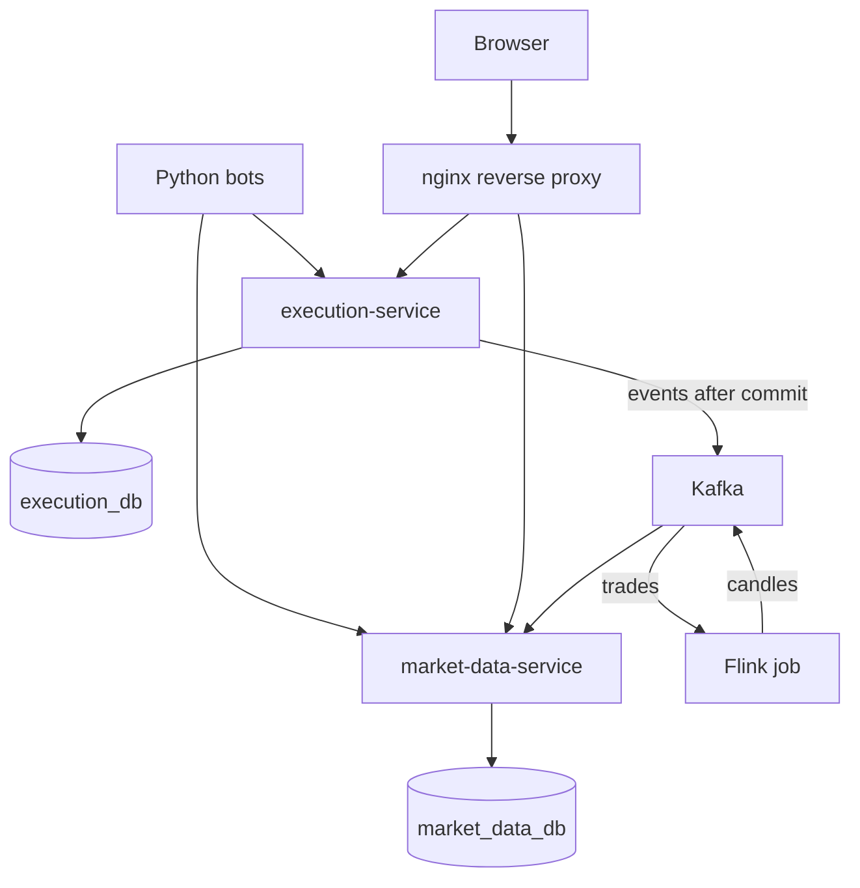

# mini-stock-exchange

A simulated, browser-based stock exchange. People and Python bots trade virtual cash and shares through the same API and rules, and prices emerge from executions against a price-time-priority limit order book. No real money or external market data is involved.

**Status:** early development. All services build and run, and login works through the API. The matching engine and the trading terminal are not built yet.

## Architecture



| Path | Role |
| --- | --- |
| `services/execution-service` | Orders, matching, risk and settlement, committed in one database transaction |
| `services/market-data-service` | Rebuildable public market data |
| `analytics-job` | Flink job that turns trades into one-minute candles |
| `event-contracts` | Avro message schemas shared by the Java modules |
| `api` | The OpenAPI 3.1 contract for the HTTP API |
| `web` | React terminal and the reverse proxy |
| `simulator` | Trading bots |
| `infra` | Database, Kafka and monitoring setup |

Each service owns its own database, with no shared access. Kafka sits downstream of the commit, so trading keeps working if Kafka or Flink is down, and public data goes stale until they return.

[docs/architecture.md](docs/architecture.md) goes further: who owns what, how an order moves through the system, order and market states, the data model, recovery, and where each requirement is met.

## Tech stack

| Area | Technology |
| --- | --- |
| Services | Java 25 (Oracle JDK 25.0.5), Spring Boot 4.1.2, Maven 3.9.16 |
| Persistence | PostgreSQL 18.6, Flyway, plain SQL through `JdbcClient` |
| Messaging | Apache Kafka 4.3.2 (KRaft), Avro 1.12.2 |
| Stream processing | Apache Flink 2.2.1 on Java 17 |
| Frontend | React 19.3, TypeScript 6, Vite 8, TanStack Query and Table, React Router, Lightweight Charts |
| Simulator | Python 3.14 with uv, HTTPX, Pydantic, NumPy |
| Runtime | Docker Compose, nginx, Prometheus, Grafana |
| Testing | JUnit, AssertJ, Testcontainers, ArchUnit, Vitest, Testing Library, pytest, Ruff |

Exact versions are pinned in `pom.xml` files, lockfiles and `compose.yaml`, where images are pinned by digest.

## Run it

You need Docker with Compose v2. On Windows PowerShell:

```powershell
.\scripts\init-env.ps1
docker compose --profile full up -d --build --wait
```

On Linux or macOS, run `./scripts/init-env.sh` instead of the first command. The app is then on <http://localhost:8080>.

`init-env` creates a local `.env` with random secrets. Its `DEV_TRADER_PASSWORD` and `DEV_OPERATOR_PASSWORD` are the passwords for the demo users `trader` and `operator`.

On first start, the full profile sets up a demo market: NOVA, ORBT, HELI, QUAD and VELO at their reference prices, the trader funded with USD 100,000.00 and 1,000 shares of each, 20 funded bots, and the market open. Start the bots from the operator screen, and trade as `trader`. Set `MSE_DEMO_SEED=false` in `.env` to start with an empty market instead, which the operator sets up.

[docs/demo.md](docs/demo.md) is a five-minute scripted walk through it: bots, orders, fills, a halt, and analytics failing without stopping trading.

`init-env` also warns when a host port in `.env` is already taken on this machine; change that port in `.env` before starting.

| Command | Starts |
| --- | --- |
| `docker compose up -d --build --wait` | Services, proxy, PostgreSQL and Kafka |
| `docker compose --profile full up -d --build --wait` | The above, plus Flink and the simulator |
| `docker compose --profile observability up -d --wait` | The base stack, plus Prometheus and Grafana |
| `docker compose down` | Stops everything; add `-v` to delete the data too |

`scripts/backup.sh` (`backup.ps1`) saves Execution's database, which every other store is derived from, and `scripts/restore.sh` (`restore.ps1`) restores one and rebuilds Kafka, Market Data and the candles from it. [docs/runbook.md](docs/runbook.md) covers those and the other recoveries: a halted engine, an unknown command outcome, a stalled outbox, Flink and Market Data.

With the observability profile, Grafana is on <http://localhost:13000> (user `admin`, password `GRAFANA_ADMIN_PASSWORD` from `.env`). Its "Mini Stock Exchange" dashboard shows trading commands per second against latency from admission to committed result, with the 150 ms and 500 ms budgets marked, plus the writer queue, the database pool, the outbox, the Market Data feeds and the JVMs. It is provisioned from `infra/grafana/dashboards/`, and Grafana refuses edits in its UI, so change the file instead.

The simulator's bots trade only during a bot run. Provision bots as the operator during setup and open the market, then start a run with `POST /api/v1/admin/bot-runs`. The run sets how many bots follow each strategy, the seed, the command rate across all its bots, order and position limits, the instruments and an optional duration. `POST /api/v1/admin/bot-runs/{runId}/stop` ends it: the bots stop trading, their open orders are cancelled, and the run shows `STOPPED` once the simulator confirms. One run runs at a time.

Each trader's account may send ten trading commands (places and cancels) a second, and each bot account two, with up to that many at once; `mse.trading.human-commands-per-second` and `mse.trading.bot-commands-per-second` change them. A command over the limit is answered `429 RATE_LIMITED` with `Retry-After` before it is queued, so sending it again under the same key is safe.

### Run a published release

Each version tag publishes its images to GitHub Container Registry. To run one without building, check out its tag and start it with the release override:

```bash
git checkout v0.1.0
./scripts/init-env.sh
MSE_VERSION=v0.1.0 docker compose -f compose.yaml -f compose.release.yaml --profile full up -d --no-build --wait
```

In PowerShell, set the version first with `$env:MSE_VERSION = 'v0.1.0'`. The images are `ghcr.io/princz-mia/mini-stock-exchange/<image>:<version>` for `execution-service`, `market-data-service`, `web`, `simulator` and `analytics-job`.

## Develop

You need Oracle JDK 25.0.5, a JDK 17 for the Flink tests, Node.js 24.22.2, uv and Docker. Point `JAVA_HOME` at JDK 25 and `JAVA17_HOME` at JDK 17, then:

```powershell
.\mvnw.cmd -B -ntp test                                        # unit tests, no Docker needed
.\mvnw.cmd -B -ntp verify                                      # plus integration tests against real PostgreSQL
.\mvnw.cmd -B -ntp -pl services/execution-service -am verify   # one service
.\scripts\compat-gate.ps1                                      # full stack check in a throwaway Compose project
```

```powershell
cd web; npm ci; npm run typecheck; npm run lint; npm test; npm run build; cd ..
cd simulator; uv sync --frozen; uv run --frozen ruff check .; uv run --frozen pytest -q; cd ..
```

On Linux or macOS, use `sh ./mvnw` and `bash scripts/compat-gate.sh`.

### Matcher benchmark

```powershell
.\mvnw.cmd -B -ntp -pl services/execution-service -Pjmh -DskipTests clean test-compile exec:exec@jmh
```

A JMH benchmark of the order book alone, with no database: the same recorded 10,000 commands replayed on a quiet and a busy book, timing each command's matching and snapshot depth. Results go to `services/execution-service/target/jmh-result.json`; `-Djmh.args="MatcherBenchmark -prof gc"` passes other JMH options. The `clean` is needed so the benchmark list is generated.

### Writer replay

```powershell
.\mvnw.cmd -B -ntp -pl services/execution-service verify "-Dtest=None" "-Dsurefire.failIfNoSpecifiedTests=false" "-Dit.test=EngineReplayBench"
```

Sends the same seeded 12,000 orders and cancels, one at a time, through the real engine and PostgreSQL (in Testcontainers), and reports throughput, latency and a digest of every answer. Equal digests show two runs did the same work, so a change to the writer can be compared before and after on identical data. The report goes to `services/execution-service/target/engine-replay-<time>.txt`.

### Load test

```powershell
uv run --project simulator python -m mse_simulator.loadtest   # about 20 minutes
```

It starts its own throwaway Compose project (`mse-load`, on port 38080) with five instruments and 1,000 bots, runs them at 100 trading commands a second, and measures 10 minutes after a 2-minute warm-up. A trader places and cancels once a second through the proxy for client latency. Afterwards it restarts Execution, whose startup reconciliation refuses to start on any accounting mismatch, and checks that every trade reached Market Data and the candles reconcile. The report goes to `runtime/load-test/`, and the exit code is 0 only when every budget is met: p95 within 150 ms and p99 within 500 ms from admission to committed result, no sustained queue growth, and under 0.1% unexpected failures. `--help` lists the options for shorter or smaller runs. Measured results are in [docs/benchmarks.md](docs/benchmarks.md).

### Browser tests

`web/e2e/` holds Playwright tests that drive the real stack through the reverse proxy. `operator-setup.spec.ts` runs first, on the fresh stack: the operator adds a named instrument in the setup editor, changes its name and price, removes the name and deletes it, leaving an empty market in setup. Then the trading tests sign in, buy into a partial fill, cancel the rest, check the portfolio, then check the layout at phone width. They set up their market through the operator API: an instrument, two funded traders, then opening.

`trading-screens.spec.ts` then checks every screen at 1440x900, 1280x720 and 390x844: sign-in, the terminal, the portfolio and the operator screen, each in its states (a refused sign-in, a rejected order, a busy exchange, a rate limit, an order that was not placed, stale or lost market data, empty and unreachable data). States the stack won't produce on demand are made by answering those requests in the browser. Nothing may scroll sideways, both sides of the order book must fit their panel, and a full-page screenshot of each goes to `web/test-results/screens/` for review.

The compatibility gate runs them. It inserts the counterparty's login from `web/e2e/seed-users.sql` into its throwaway stack, because users have no API. It then runs `npm run e2e` with these variables:

- `E2E_BASE_URL`: the stack's address.
- `E2E_TRADER_PASSWORD`: the dev trader's password.
- `E2E_OPERATOR_PASSWORD`: the dev operator's password.
- `E2E_COUNTERPARTY_PASSWORD`: the counterparty's password.

The tests need a fresh stack, with no market set up yet. Install the browser once with `cd web; npx playwright install chromium`.

### The API contract

`api/openapi.yaml` is the source of truth for the HTTP API. To change an endpoint, change the contract first, then the code:

- `cd web; npm run api:generate` regenerates the TypeScript types in `web/src/api/schema.ts`. CI runs `npm run api:check` and fails if they are out of date.
- Each service's `ApiContractIT` checks real responses against the contract's schemas, and checks that the routes it serves are exactly the operations tagged with its name.

### Event schemas

`event-contracts/src/main/avro/` holds the current Avro schema of each event. Every schema ever published is also kept, as `<Type>-v<version>.avsc` under `event-contracts/src/main/resources/com/mia_princz/mse/contracts/events/writers/`, and listed in `catalogue.txt` there with its fingerprint. Payloads name their writer by fingerprint, so consumers can read anything still on a topic.

To change a schema:

1. Edit the `.avsc` in `src/main/avro/`. New fields need a default, so older payloads still decode.
2. Copy the result into `writers/` as the next version, and add its line to `catalogue.txt`. Never edit or remove an earlier one.
3. Build `event-contracts`. Its tests fail if the current schema isn't the newest retained writer, if a retained file changed, or if the current schema can't read every retained writer. Both services and the analytics job then decode every retained writer in their own `RetainedWritersDecodeTest`.

A payload from a writer outside the catalogue stops the consumer instead of being skipped.

New fields default to nothing (null, false, zero or empty), so an older payload never says more than its writer did, and enum symbols are only ever appended; the catalogue's tests check both. Deploy the readers before the writer: a service that doesn't know a writer stops on its payloads, and once a newer writer's payload is on a compacted topic, a reader can't be rolled back past it.

Run `git config core.hooksPath .githooks` once after cloning. It enables a hook that checks commit messages follow [Conventional Commits](https://www.conventionalcommits.org/). Pull requests need green CI, and new database tables need explicit `GRANT`s to the service's runtime role in their migration.
