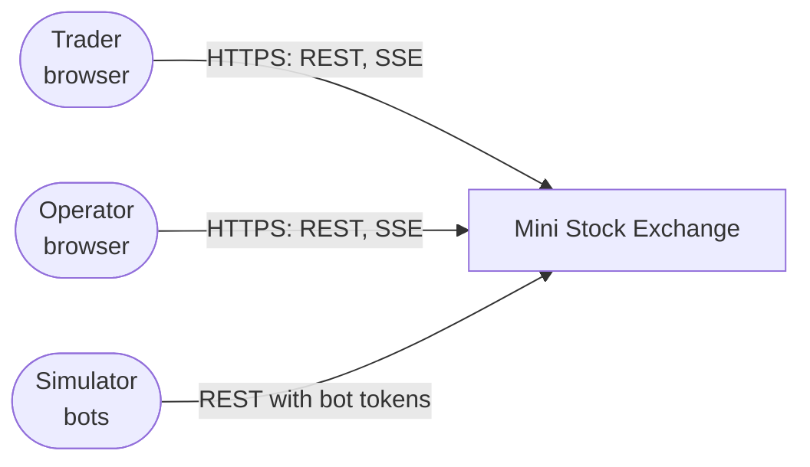
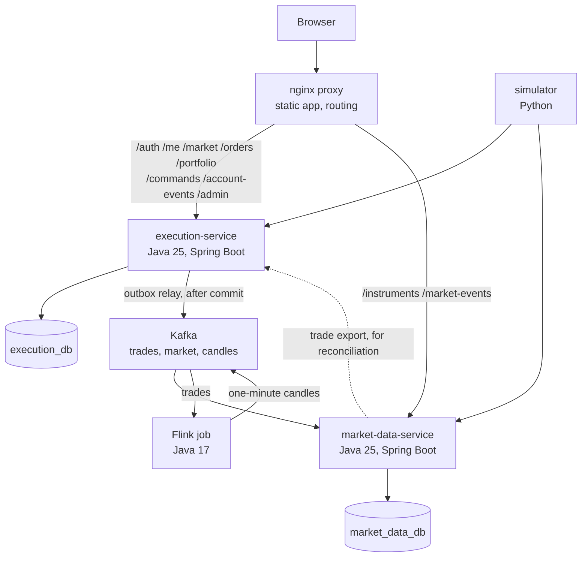
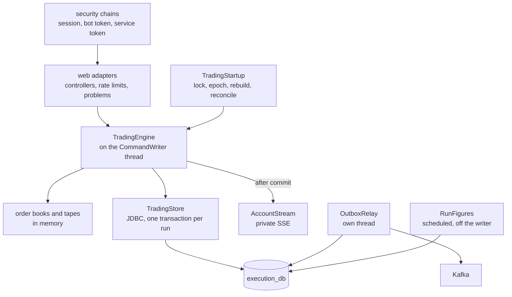
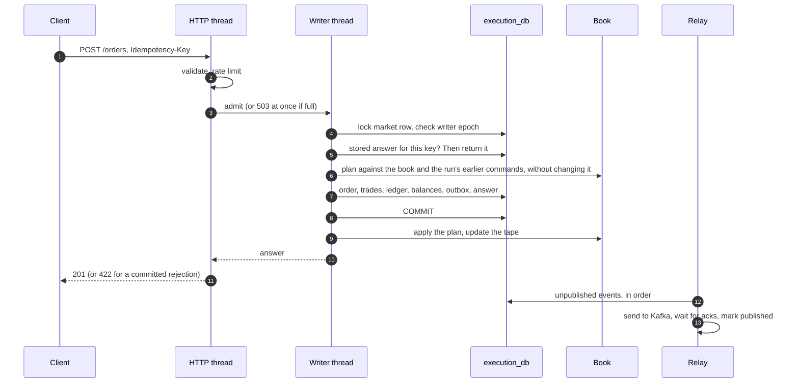
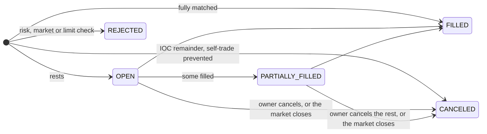
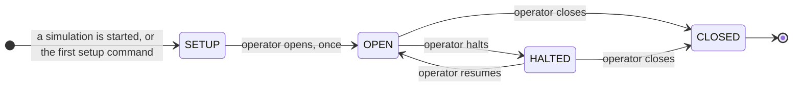
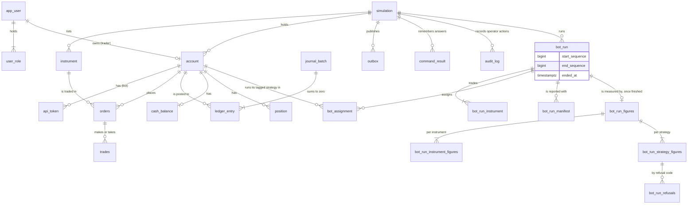
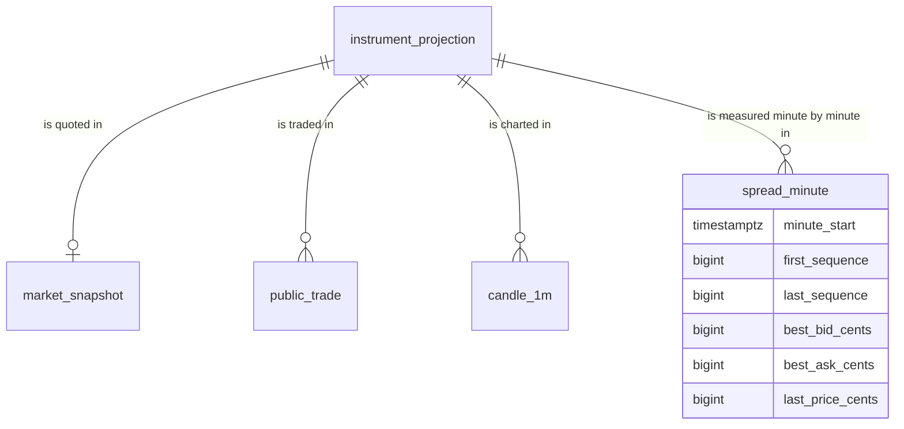
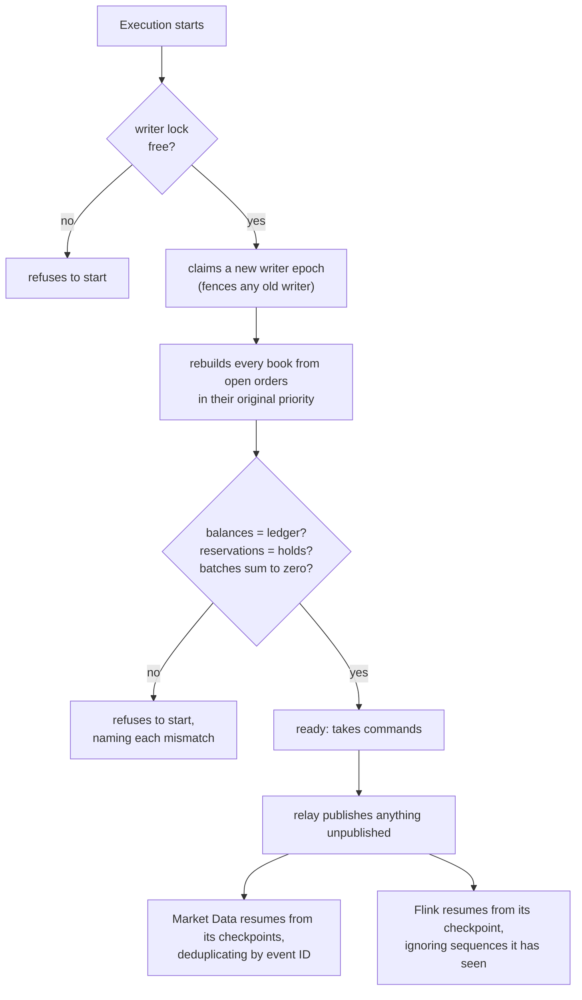

# Architecture

How the exchange is put together, who owns what, and how a command, a failure and a recovery move through it. The [README](../README.md) has the repository map and commands, the [runbook](runbook.md) the operating procedures, and [benchmarks](benchmarks.md) the measured performance.

## Context

**Users:**
- **Traders** sign in, watch the market and trade with virtual funds.
- **The operator** sets the market up (instruments, accounts, bots), opens, halts and resumes it, starts and stops bot runs, and compares finished runs. The operator's login may also trade, like a trader's.
- **The simulator** runs bots that trade like any client, each with its own credential.

Everything runs locally under Docker Compose; there are no external systems.

## Containers

| Container | Owns | Never does |
| --- | --- | --- |
| **execution-service** | Identity, accounts, instruments, market state, orders, matching, risk, settlement, the ledger, bot configuration, bot runs and their figures; private REST and the private stream | Serve public market history |
| **market-data-service** | Rebuildable public projections: instruments, snapshots, the tape, candles; public REST and the public stream | Touch money, or write anything Execution reads |
| **Flink job** | One-minute candles (OHLCV and VWAP) from the trade stream | Read either database |
| **nginx** | One origin for the app, the APIs and both streams; security headers | Business logic; forwarding `/internal` |
| **simulator** | Bots that follow an operator's bot run | Anything a client couldn't do |

**Each service has its own database, owner role, runtime role and migrations.** Neither can read the other's: the gate checks that the cross-service access is denied. They meet only through Kafka and HTTP.

Kafka sits after the commit, so trading keeps working if Kafka or Flink is down. Public data then goes stale, and says so.

## Components of Execution

**Packages:**
- **`trading`:** a pure `domain` (prices, money, the order book, matching, settlement), an `application` layer (the engine, the writer, ports), and `adapter`s for JDBC and the web.
- **`identity`:** users and their roles (one user may hold both: operating and trading), sessions and bot tokens. The operator adds trader logins during SETUP, through the writer like any SETUP command; configuration creates only the operator's login, which holds both roles, and the demo seed adds its trader the same way the operator would.
- **`outbox`:** the relay.
- **`operations`:** security and configuration.

Architecture tests keep the domain free of Spring, SQL and Kafka, and keep the application layer reaching the database only through its ports.

**The single writer** ([why](#decisions)): every order, cancel and operator command runs on one thread, in admission order. Orders and cancels waiting in the queue together run as one database transaction, a run of up to 32 in Compose, so they share one commit; an operator command runs alone. HTTP threads only validate, rate-limit and queue, and a full queue answers `503` at once.

**Run figures** come from `RunFigures`, a scheduled pass in the `trading` package's JDBC adapter. It runs outside the writer, every 5 seconds by default (`mse.runs.figures-interval`). Each pass takes up to five finished runs that have no figures yet, oldest first. For each, it reads the run's window from `execution_db` in one repeatable-read snapshot and writes the figures in the same transaction. A run that fails is tried again on the next pass, and the runs after it are not held back.

## Placing an order

- **A rejection is committed too,** with its reason, so retrying the key returns it.
- **On a rollback** the plan is discarded and nothing changes.
- **If the commit's outcome is unknown,** or the book can't apply a committed plan, the writer halts instead of guessing, and a restart rebuilds.
- **A cancel** follows the same path: lock, check the owner, release the reservation, commit, then remove the order from the book.
- **In a run,** the lock and the commit happen once. When the run commits, every command keeps its own answer, sequence and rows, exactly as if it had run alone. A failure that doesn't halt rolls the run back and runs its commands again one at a time. If the run halts the writer, the commands already answered keep their answers and the rest fail, whether or not they committed; after a restart, each key says what happened. The limit is the `mse.trading.max-batch` setting, 32 in `compose.yaml`; at 1, every command runs alone.

**Answers and retries.** If the answer takes longer than five seconds, the client gets `504 COMMAND_OUTCOME_UNKNOWN`. It looks the key up: `404` means nothing committed, and the same key may be sent again.

## States

Orders keep `quantity = filled + working + canceled`.

**Order types:**
- a limit order is good till cancelled and may rest;
- a market order is immediate-or-cancel with a protection price, and never rests.

These are the states of one simulation. Simulations follow each other: once one is CLOSED the operator starts the next, which begins in SETUP. At most one simulation is not closed, which a unique index guarantees, and every read and command means the **current** one: the one that is not closed or, once every one is, the one created last.

**In each state:**
- **SETUP:** instruments, trader accounts and bots are configured. Each batch of bots is tagged with a strategy (market maker, noise or momentum), fixed once the bot exists. An instrument's reference price and display name can still be changed, and an instrument nothing uses yet can be deleted: no account was given its shares and no order named it. Nothing trades. Once the market opens, the catalogue is frozen; a database trigger refuses a change or a delete outside SETUP too.
- **HALTED:** keeps the books. Cancels are accepted, new orders aren't.
- **CLOSED:** final. Nothing rests and nothing trades: an order is rejected with `MARKET_CLOSED`, no bot run starts, and no transition leads out. Nothing is deleted, so portfolios, orders, trades, accounts and runs stay readable.

**Closing** is one command on the writer, allowed from OPEN and from HALTED, that nothing else comes between:
- **In its own transaction,** at its sequence: the state and the time it closed; every bot run that had not ended ends there, with no worker to confirm it; every bot token is revoked; and each instrument's snapshot says `CLOSED`, its last price being its final one.
- **Every resting order is cancelled** with the reason `MARKET_CLOSED` and its hold released, exactly as its owner's cancel would. The first 5,000 go with the close; the rest follow in further transactions of 5,000, each with its own sequence, stored answer and audit row, because all of them in one would hold the writer for one very large commit. The books change after each commit, as for every command. Orders not yet cancelled keep their holds, so the market reconciles between two of them.
- **If the process stops in between,** the next one finishes cancelling while it starts, before it takes a command. A restart finds the closed market and loads it like any other, so that it goes on answering as closed, and removes its bots' token files if the close had not.
- **A running writer never keeps a market half closed.** One of the later transactions that fails and rolls back is tried again, three times in all. If the orders still cannot all be cancelled, the writer halts, as it does whenever it can't trust what it holds, and the restart finishes the close. So a writer that takes commands for a closed market has nothing resting.
- **A close that halted is on record and is answered, whoever is still waiting.** The request waits 45 seconds and then answers `504`, and a close that can't finish may take longer than that to give up. So the writer itself logs the halt, with the close's sequence, how many orders its books still hold and the cause, and keeps the unfinished close. Health goes down, and every close sent until the restart is answered `503 MARKET_CLOSE_UNFINISHED`: the request that closed, if it is still waiting, and its key sent again after a `504`. The count in the answer is an upper bound, because a transaction whose outcome is unknown may have cancelled up to 5,000 of those orders already. Other commands are answered `503 TRADING_UNAVAILABLE`.

**Starting a new simulation** is one command on the writer, allowed when the current simulation is CLOSED and when none exists, and one transaction:
- **The closed simulation is retired.** Its row is locked while this writer still owns it, and its writer epoch is set to 0. A market is created at epoch 1 and every takeover adds one, so no writer ever holds 0: every command opens by matching its epoch against the row, and nothing matches 0, so no process can open a command in a closed simulation that has a successor. A process that still holds the closed simulation's ID halts at its next command, as any stale writer does.
- **The new simulation is written** in SETUP with its name, its own issuance account, and the writer's epoch, so every later command opens with the same one statement as before. The start is its first command: sequence 1, with its stored answer and its audit row in the new simulation.
- **Nothing in memory changes before the commit.** After it the engine writes for the new simulation and has dropped every book, instrument, tape, count of resting orders and account of the closed one, and tells whoever keeps something per account: the rate limits forget every account, and the private streams are closed and their versions forgotten.
- **A start is refused** while a simulation that has not closed exists, with that simulation's state, and when another simulation has the name. A refusal is a command of the current simulation: sequenced, stored and audited there.
- **Its key is looked up in every simulation,** where every other command's key is looked up in the current one only. After another start the first answer is out of the current simulation's reach, and the same request would start one more. So a start's first answer, started or refused, is its answer for good.

**What is kept.** Everything. A closed simulation keeps its accounts, orders, trades, ledger, runs, stored answers and audit rows, and is never written again. Command sequences, trade sequences and idempotency keys belong to one simulation, so each starts again and the same key in two simulations is two commands. Logins are global and accounts belong to one simulation, so a trader is funded again in each, and a symbol is free again. A process that starts with closed simulations and a newer one loads the newer one only: it rebuilds and reconciles that one and claims its epoch. Reading a closed simulation that has a successor through the API is not there yet.

## Data

**In `execution_db`:**
- **The ledger:** append-only `ledger_entry` rows in `journal_batch`es, each summing to zero per asset, with available and reserved buckets.
- **Balances and positions:** `cash_balance` and `position` are the ledger's running totals, and the startup reconciliation compares them with it.
- **Bot runs:** each strategy in a run is assigned to the oldest bots tagged with it, and a foreign key from `bot_assignment` to the bot's tag refuses any other assignment. Neither the population nor a run has a size limit, so the simulator reads a run's bots in pages, once, since they never change. A run's window is a range of command sequences: from its start command to its last command, which is recorded when its worker confirms the stop, after the run's closing cancels. A new run waits while a worker is still finishing the previous one; if that worker has gone quiet, or there never was one, the new run's start ends the previous run instead. Windows never overlap, and each instrument's newest trade sequence is kept at both edges. The time a window ended is kept beside its last command (`ended_at`), so a run's length is exact whichever way it ended. Once a run is finished, a background pass computes its figures once from its window, off the writer, and stores them in `bot_run_figures` and the tables under it: the trades in its instruments, and per strategy its bots' commands, refusals by code, fills and estimated profit or loss, marked at the newest trade at each edge. The worker also reports a manifest with its first heartbeat of a run: its version and commit, the runtime its decisions depend on, and its strategy settings. The first stays the run's and never changes; a different one, from a worker that took the run over with other code, is kept beside it and counted.
- **Resting orders** are limited per account (20 by default) and across the market (200,000), so a market of 10,000 bots fits; the market-wide count comes from the in-memory books, not a query per order.
- **Answers and events:** `command_result` stores each idempotency key's answer, and `outbox` holds every event ever published.
- **Sessions** are `spring_session` rows, written through their own small connection pool whose commits don't wait for the WAL flush. Each signed-in request saves its last access, so this keeps a commit per request off the trading writer's path. If PostgreSQL itself crashes, session changes from its last fraction of a second may be lost: a trader signs in again, or a sign-out in that instant is undone. Everything else stays durable.

**In `market_data_db`:**
- `instrument_projection`, `market_snapshot` (depth and quotes), `public_trade` and `candle_1m`;
- `instrument_session` and `session_minute`, each instrument's figures since trading began, kept with the public trades;
- `spread_minute`, each instrument's book minute by minute (best bid and ask, last price, and the command sequences each minute covers), from the market snapshots, for market quality over a window of sequences;
- `processed_event`, for deduplication, and `projection_checkpoint`, the Kafka offsets.

All of it is derived and can be rebuilt from Kafka, except the minutes of `spread_minute` older than what the compacted market topic still holds, after a rebuild or a long enough pause of the market feed; a restore republishes every snapshot and rebuilds those too.

**Comparing runs** adds no state to either service. The operator ticks two to four finished runs and opens `/operator/runs/compare`. The browser takes each run's stored figures and manifest from Execution (`GET /api/v1/admin/bot-runs/{runId}`), and each instrument's minutes from Market Data's market-quality endpoint (`GET /api/v1/instruments/{instrumentId}/market-quality`) over the run's window of command sequences. It lines the minutes up from each run's start, so runs from different hours sit side by side, and it names the simulator settings that differ between them.

**Money** is whole cents in a `long` everywhere, with overflow checked, and `BIGINT` in the databases. **Quantities** are whole shares.

## Recovery

| Failure | What happens | What brings it back |
| --- | --- | --- |
| Execution dies mid-trading | Uncommitted work rolls back; clients retry by key | Restart: lock, epoch, rebuild, reconcile |
| A commit's answer is lost | The writer halts | Restart; the key returns the stored answer |
| Kafka is down | Trading continues; the outbox grows; public data says it is behind | Kafka returns; the relay publishes the backlog in order |
| The outbox backlog hits its limit | New orders refused, cancels accepted | The backlog drains |
| Flink is down or restarts | Candles fall behind and say so | Resumes from its checkpoint |
| Market Data loses its database | — | Rebuilds from Kafka's topics |
| A projection write fails | The batch rolls back and is retried; nothing skipped | The cause is fixed |
| Execution's database is lost | — | Restore a backup; everything derived is rebuilt from it |

The gate rehearses each of these, and compares Execution's trade totals with Market Data's and reconciles every candle with Execution's trade export afterwards.

## Decisions

The main decisions, each with its consequences and the condition for revisiting it:
- **Two services, with every financial effect of a command committed in one transaction** in Execution, instead of a distributed saga.
- **One writer thread for every trading mutation,** fenced across processes by a database lock and a writer epoch.
- **The database commits first and the in-memory book follows,** with a halt instead of a guess when they might disagree.
- **Events leave through an outbox,** at least once and in order, with idempotent consumers.
- **Analytics as a separate Flink job** that reads Kafka only, never a database, so its failure can't touch trading.
- **Whole cents in a `long`** for every amount, with overflow checked.
- **Server-side sessions for people and hashed bearer tokens for bots.** The private stream carries only account versions and is tied to the session. Session writes commit asynchronously; revisit if a lost sign-out ever matters more than a commit per request.
- **An operator who may also trade,** with one login holding both roles. In a simulation it can halt, resume and edit the setup of the market it trades in, and it sees every account's allocation and every run's figures. This is accepted for a teaching simulation; revisit if the exchange ever has traders who compete for real.

## Requirements and where they are met

| | Capability | Where |
| --- | --- | --- |
| F01 | Access | Session login with CSRF and bcrypt; trader and operator roles, which one user may both hold, with one session for both; trader logins added by the operator during SETUP, their passwords stored only as bcrypt hashes, and changed by the trader with the current one, which signs out their other sessions; accounts taken from the credential, never the request; scoped, revocable bot tokens; a failed sign-in limit |
| F02 | Orders | Limit GTC and protected market IOC; committed rejections with reasons; idempotency keys; command lookup |
| F03 | Matching | Price then acceptance sequence; the resting order's price; partial fills; self-trade prevention (`domain/OrderBook`) |
| F04 | Accounting | Reservations, executions, transfers and releases as balanced ledger batches in one transaction; no negative balances, enforced by checks and reconciled at startup |
| F05 | Terminal | Live depth, tape and chart from the public stream; ticket, own orders, holdings and cash from REST, refreshed by the private stream; a notice when a resting order fills; under Help, a tour for each role, shown once by itself, and a "How this exchange works" page; term tips that explain the market's words where they appear |
| F06 | Market control | Instruments, endowments and bots in SETUP; open, halt, resume and close, and starting the next simulation, as sequenced, audited commands |
| F07 | Simulation | Market-maker, noise and momentum bots; seeded runs with rate, limits and duration; heartbeats and activity telemetry; each run's window of command sequences; figures per instrument and strategy, computed once a run finishes (`RunFigures`); the simulator's manifest with each run; two to four finished runs compared side by side, with their market quality from Market Data |
| F08 | Analytics | Outbox, Kafka and Avro, the Flink job, Kafka again, then PostgreSQL candles, reconciled exactly with the trade export |
| F09 | Reliability | Idempotent commands; restart rebuild and reconciliation; bounded queue and rate limits; outbox admission; analytics isolated from trading; backup and restore |
| F10 | Evidence | Unit, integration, browser and gate tests with planted bugs; [benchmarks](benchmarks.md); this document, with its main decisions and their trade-offs under [Decisions](#decisions); the [runbook](runbook.md) |
