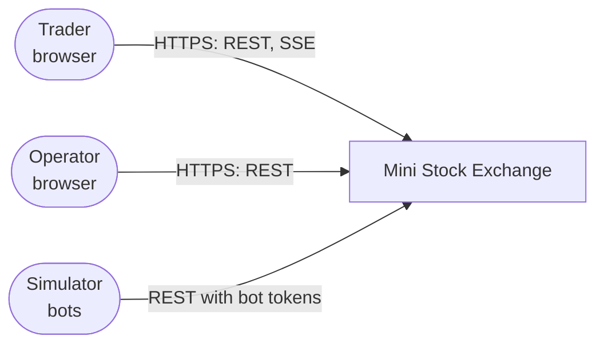
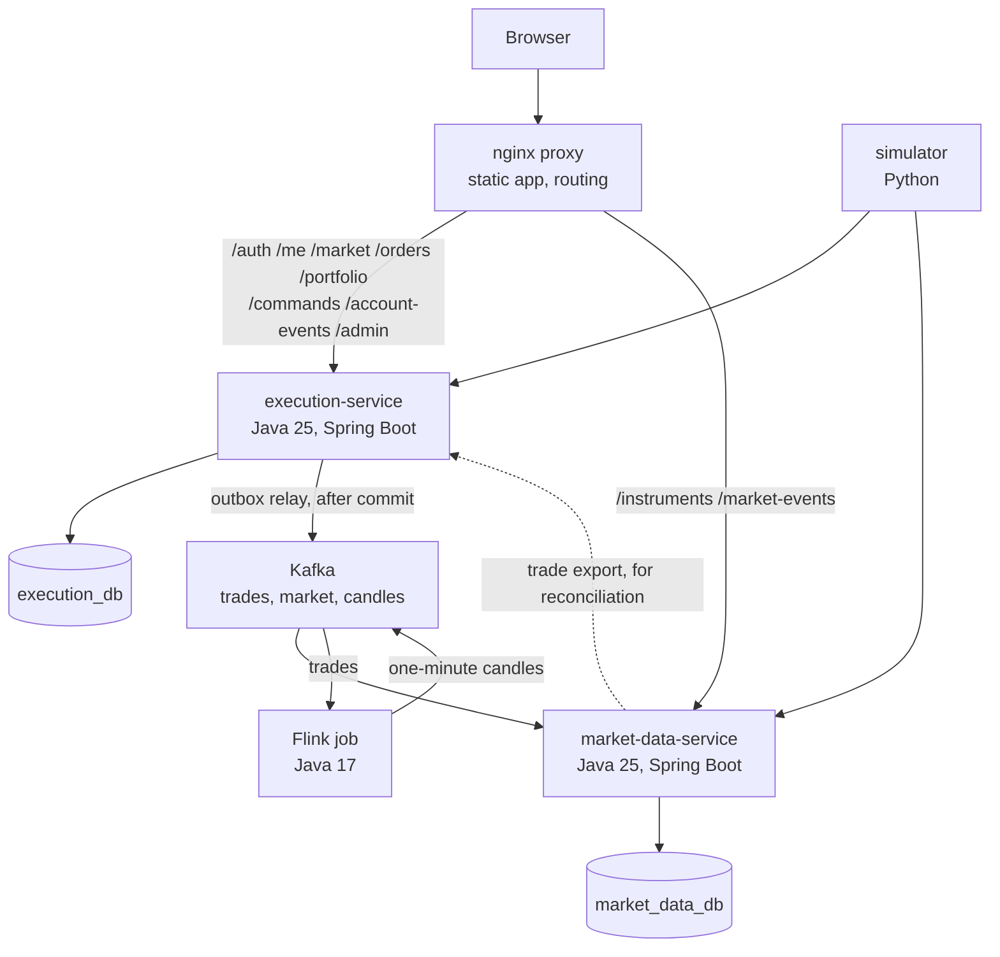
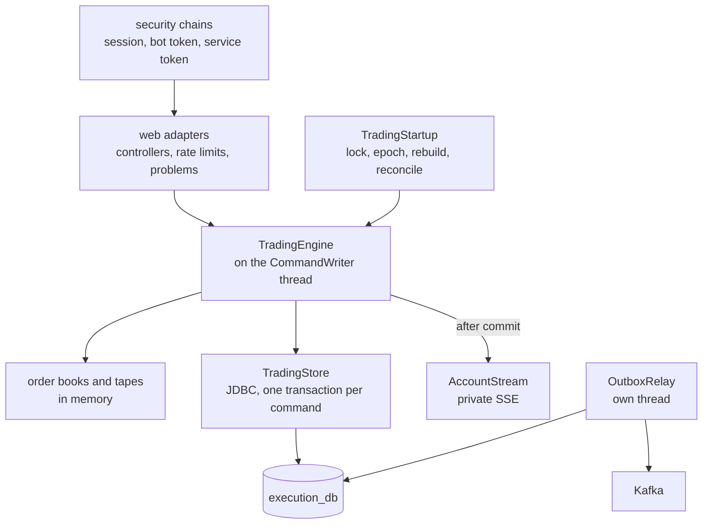
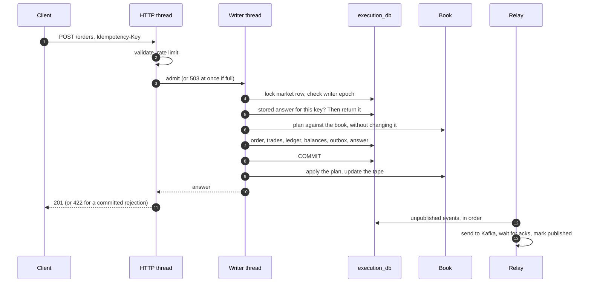
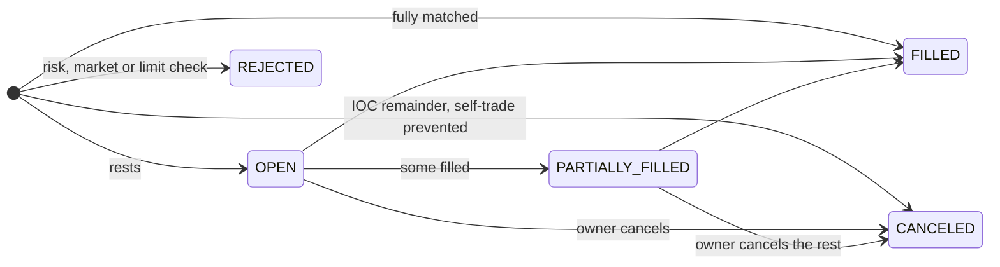
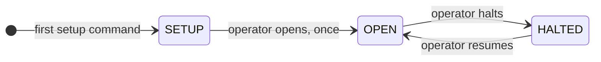
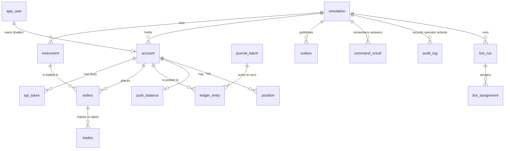
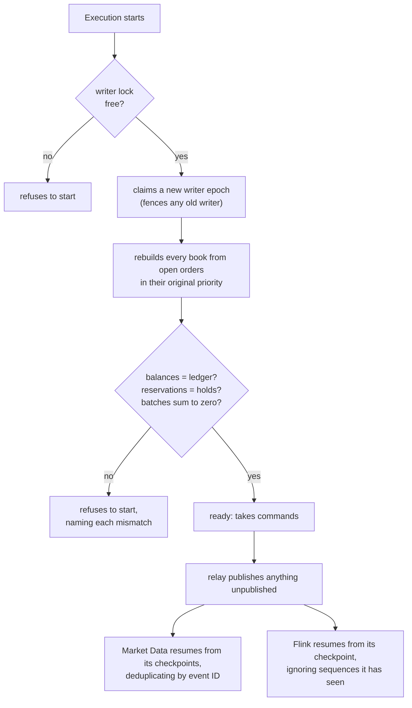

# Architecture

How the exchange is put together, who owns what, and how a command, a failure and a recovery move through it. The [README](../README.md) has the repository map and commands, the [runbook](runbook.md) the operating procedures, and [benchmarks](benchmarks.md) the measured performance.

## Context

**Users:**
- **Traders** sign in, watch the market and trade with virtual funds.
- **The operator** sets the market up (instruments, accounts, bots), opens, halts and resumes it, and starts and stops bot runs.
- **The simulator** runs bots that trade like any client, each with its own credential.

Everything runs locally under Docker Compose; there are no external systems.

## Containers

| Container | Owns | Never does |
| --- | --- | --- |
| **execution-service** | Identity, accounts, instruments, market state, orders, matching, risk, settlement, the ledger, bot configuration; private REST and the private stream | Serve public market history |
| **market-data-service** | Rebuildable public projections: instruments, snapshots, the tape, candles; public REST and the public stream | Touch money, or write anything Execution reads |
| **Flink job** | One-minute candles (OHLCV and VWAP) from the trade stream | Read either database |
| **nginx** | One origin for the app, the APIs and both streams; security headers | Business logic; forwarding `/internal` |
| **simulator** | Bots that follow an operator's bot run | Anything a client couldn't do |

**Each service has its own database, owner role, runtime role and migrations.** Neither can read the other's: the gate checks that the cross-service access is denied. They meet only through Kafka and HTTP.

Kafka sits after the commit, so trading keeps working if Kafka or Flink is down. Public data then goes stale, and says so.

## Components of Execution

**Packages:**
- **`trading`:** a pure `domain` (prices, money, the order book, matching, settlement), an `application` layer (the engine, the writer, ports), and `adapter`s for JDBC and the web.
- **`identity`:** users, sessions and bot tokens.
- **`outbox`:** the relay.
- **`operations`:** security and configuration.

Architecture tests keep the domain free of Spring, SQL and Kafka, and keep the application layer reaching the database only through its ports.

**The single writer** ([why](#decisions)): every order, cancel and operator command runs on one thread, in admission order, each as one database transaction. HTTP threads only validate, rate-limit and queue, and a full queue answers `503` at once.

## Placing an order

- **A rejection is committed too,** with its reason, so retrying the key returns it.
- **On a rollback** the plan is discarded and nothing changes.
- **If the commit's outcome is unknown,** or the book can't apply a committed plan, the writer halts instead of guessing, and a restart rebuilds.
- **A cancel** follows the same path: lock, check the owner, release the reservation, commit, then remove the order from the book.

**Answers and retries.** If the answer takes longer than five seconds, the client gets `504 COMMAND_OUTCOME_UNKNOWN`. It looks the key up: `404` means nothing committed, and the same key may be sent again.

## States

Orders keep `quantity = filled + working + canceled`.

**Order types:**
- a limit order is good till cancelled and may rest;
- a market order is immediate-or-cancel with a protection price, and never rests.

**In each state:**
- **SETUP:** instruments, trader accounts and bots are configured. Nothing trades.
- **HALTED:** keeps the books. Cancels are accepted, new orders aren't.

## Data

**In `execution_db`:**
- **The ledger:** append-only `ledger_entry` rows in `journal_batch`es, each summing to zero per asset, with available and reserved buckets.
- **Balances and positions:** `cash_balance` and `position` are the ledger's running totals, and the startup reconciliation compares them with it.
- **Answers and events:** `command_result` stores each idempotency key's answer, and `outbox` holds every event ever published.
- **Sessions** are `spring_session` rows.

**In `market_data_db`:**
- `instrument_projection`, `market_snapshot` (depth and quotes), `public_trade` and `candle_1m`;
- `instrument_session` and `session_minute`, each instrument's figures since trading began, kept with the public trades;
- `processed_event`, for deduplication, and `projection_checkpoint`, the Kafka offsets.

All of it is derived and can be rebuilt from Kafka.

**Money** is whole cents in a `long` everywhere, with overflow checked, and `BIGINT` in the databases. **Quantities** are whole shares.

## Recovery

| Failure | What happens | What brings it back |
| --- | --- | --- |
| Execution dies mid-trading | Uncommitted work rolls back; clients retry by key | Restart: lock, epoch, rebuild, reconcile |
| A commit's answer is lost | The writer halts | Restart; the key returns the stored answer |
| Kafka is down | Trading continues; the outbox grows; public data says it is behind | Kafka returns; the relay publishes the backlog in order |
| The outbox backlog hits its limit | New orders refused, cancels accepted | The backlog drains |
| Flink is down or restarts | Candles fall behind and say so | Resumes from its checkpoint |
| Market Data loses its database | — | Rebuilds from Kafka's topics |
| A projection write fails | The batch rolls back and is retried; nothing skipped | The cause is fixed |
| Execution's database is lost | — | Restore a backup; everything derived is rebuilt from it |

The gate rehearses each of these, and compares Execution's trade totals with Market Data's and reconciles every candle with Execution's trade export afterwards.

## Decisions

The main decisions, each with its consequences and the condition for revisiting it:
- **Two services, with every financial effect of a command committed in one transaction** in Execution, instead of a distributed saga.
- **One writer thread for every trading mutation,** fenced across processes by a database lock and a writer epoch.
- **The database commits first and the in-memory book follows,** with a halt instead of a guess when they might disagree.
- **Events leave through an outbox,** at least once and in order, with idempotent consumers.
- **Analytics as a separate Flink job** that reads Kafka only, never a database, so its failure can't touch trading.
- **Whole cents in a `long`** for every amount, with overflow checked.
- **Server-side sessions for people and hashed bearer tokens for bots.** The private stream carries only account versions and is tied to the session.

## Requirements and where they are met

| | Capability | Where |
| --- | --- | --- |
| F01 | Access | Session login with CSRF and bcrypt; trader and operator roles; accounts taken from the credential, never the request; scoped, revocable bot tokens; a failed sign-in limit |
| F02 | Orders | Limit GTC and protected market IOC; committed rejections with reasons; idempotency keys; command lookup |
| F03 | Matching | Price then acceptance sequence; the resting order's price; partial fills; self-trade prevention (`domain/OrderBook`) |
| F04 | Accounting | Reservations, executions, transfers and releases as balanced ledger batches in one transaction; no negative balances, enforced by checks and reconciled at startup |
| F05 | Terminal | Live depth, tape and chart from the public stream; ticket, own orders, holdings and cash from REST, refreshed by the private stream |
| F06 | Market control | Instruments, endowments and bots in SETUP; open, halt and resume as sequenced, audited commands |
| F07 | Simulation | Market-maker, noise and momentum bots; seeded runs with rate, limits and duration; heartbeats and activity telemetry |
| F08 | Analytics | Outbox, Kafka and Avro, the Flink job, Kafka again, then PostgreSQL candles, reconciled exactly with the trade export |
| F09 | Reliability | Idempotent commands; restart rebuild and reconciliation; bounded queue and rate limits; outbox admission; analytics isolated from trading; backup and restore |
| F10 | Evidence | Unit, integration, browser and gate tests with planted bugs; [benchmarks](benchmarks.md); this document; the decision records; the runbook |
